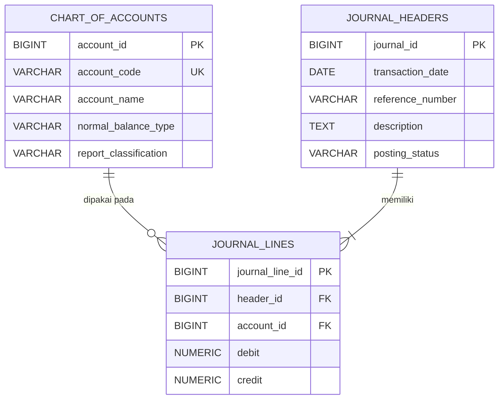

# Soal 1.1 — ERD General Ledger

## Diagram

`||--o{` berarti satu akun harus menjadi rujukan bagi setiap baris jurnal yang menggunakannya, sementara satu akun dapat belum pernah atau dapat berkali-kali digunakan. `||--|{` menggambarkan satu header jurnal dengan satu atau lebih baris. Setiap baris jurnal wajib terkait tepat dengan satu header dan satu akun. Foreign key memastikan baris tidak merujuk ke header atau akun yang tidak ada, tetapi foreign key saja tidak mewajibkan setiap header mempunyai baris.

## Tabel dan kunci

| Tabel | Kolom dan keterangan |
|---|---|
| `chart_of_accounts` | `account_id` adalah primary key teknis; `account_code` adalah kode akun yang wajib unik; `account_name` adalah nama akun; `normal_balance_type` menyatakan saldo normal (`DEBIT` atau `CREDIT`); `report_classification` menyatakan klasifikasi akun pada laporan. |
| `journal_headers` | `journal_id` adalah primary key; `transaction_date` adalah tanggal transaksi; `reference_number` adalah nomor referensi/bukti; `description` adalah uraian transaksi; `posting_status` adalah status posting. |
| `journal_lines` | `journal_line_id` adalah primary key; `header_id` adalah foreign key ke `journal_headers.journal_id`; `account_id` adalah foreign key ke `chart_of_accounts.account_id`; `debit` dan `credit` menyimpan nilai nominal masing-masing sisi. |

## Fungsi dan asumsi desain

- `chart_of_accounts` menyimpan daftar akun yang menjadi acuan pencatatan.
- `journal_headers` menyimpan informasi umum satu transaksi jurnal, satu kali untuk seluruh transaksi.
- `journal_lines` menyimpan rincian akun dan nominal debit/kredit untuk transaksi tersebut.
- `account_id` dipakai sebagai kunci teknis agar foreign key pada `journal_lines` konsisten dengan namanya. `account_code` tetap tersedia sebagai kode akun bisnis dan harus unik.
- Jenis saldo normal dibatasi secara konseptual ke `DEBIT` atau `CREDIT`. Daftar nilai `report_classification` dan `posting_status` tidak ditentukan soal, sehingga keduanya disimpan sebagai teks dan tidak diasumsikan memiliki daftar nilai tertentu.
- Kardinalitas minimum satu baris pada header adalah aturan konseptual. DDL yang diminta memakai foreign key dan pemeriksaan nilai per baris; DDL itu tidak menegakkan jumlah minimum baris maupun keseimbangan jumlah debit dan kredit lintas baris.
